# PDAN8412 POE Part 3
## ST10150702 - Jordan Muller
# 👤 Age Band Recognition from Faces
 
A Convolutional Neural Network (CNN) that predicts which of five age bands a person falls in from a photo of their face, as a first step towards facial recognition at the publisher's premises.
 


 
## Overview
 
A book press wants to start using facial recognition at its premises. Rather than jumping straight to identifying individual people, this project builds the same kind of pipeline (an aligned face goes in, a class comes out) on a problem that can be tested properly with open data: predicting a person's age band. PySpark handles all loading, quality checks, cleaning, EDA and the train/validation/test split, and TensorFlow/Keras builds and trains the CNN.
 
## Dataset
 
> Zhang, Z., Song, Y. and Qi, H. (2017). *UTKFace: Large Scale Face Dataset* [Dataset]. https://susanqq.github.io/UTKFace/
 
| | |
|---|---|
| Original size | 23,708 face images |
| Format | 200 x 200 colour JPEGs, cropped and aligned around the face |
| Labels | Age, gender and ethnicity, stored in each filename |
| Target | 5 age bands: 0-12, 13-19, 20-34, 35-54, 55+ |
| Licence | Non-commercial research only (images are not included in this repo) |
 
## Pipeline
Raw JPEG bytes (Spark)
→ Structural checks and label parsing
→ Image quality measures (brightness, contrast, sharpness, colour)
→ Exact duplicate removal (SHA-256)
→ Near-duplicate grouping (dHash + thumbnail correlation)
→ Group-aware, band-stratified train/val/test split
→ Input ablation (colour and resolution)
→ Baseline and improved CNNs in TensorFlow
→ Evaluation, fairness audit and Grad-CAM
 
## Key EDA Findings
 
### Duplicate photos with conflicting labels
Hashing every file found 375 groups of identical photos, and in 259 of them the copies carry different labels (one photo is labelled 51, 54 and 56 years old). A second pass with perceptual hashes, confirmed by thumbnail correlation, linked 1,049 re-saved or edited copies into 507 small groups, which were kept together in one split so no test photo has a copy in training.
 
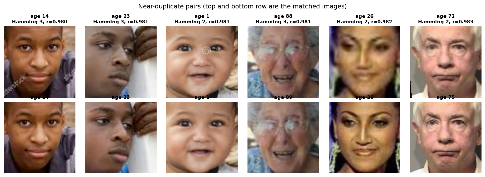
 
### The ages are estimates
Whipple's index is 134 (100 means no rounding), with ages 35, 45 and 65 holding about three times as many images as their neighbours, plus unexplained spikes at ages 1 and 26. This drove predicting bands instead of exact ages, label smoothing, and a within-one-band metric.
 
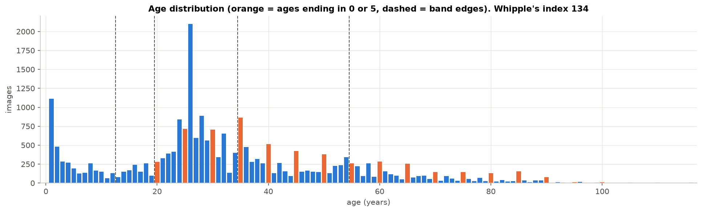
 
### Class imbalance
The 20-34 band holds 40.5% of the images and 13-19 only 5.0%, a ratio of 8.2 to 1. Macro-F1 is therefore the main metric, and the split is stratified by band.
 
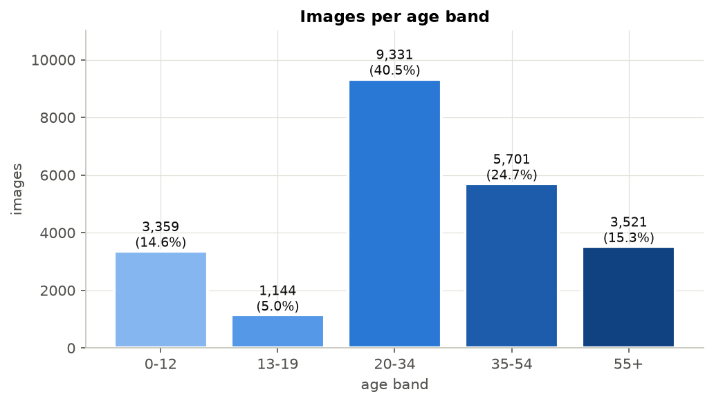
 
### Demographic mix changes by band
Gender (Cramér's V 0.19) and ethnicity (0.18) both shift between bands. The 55+ band is 66% White and children are 28% Asian, which a CNN could learn as a shortcut, so the model was audited per group.
 
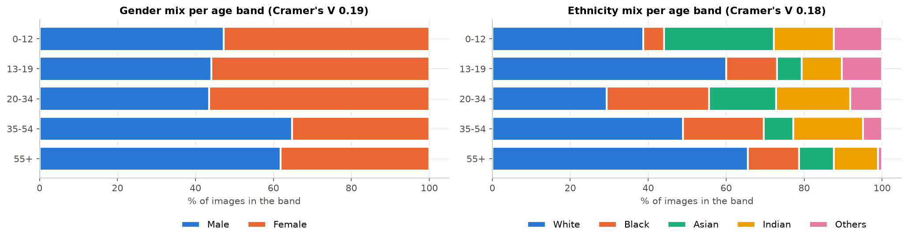
 
### Where the age signal sits
Averaging the aligned faces per band (computed in Spark) shows that age appears in fine facial detail: around the eyes, mouth, cheeks and hairline.
 
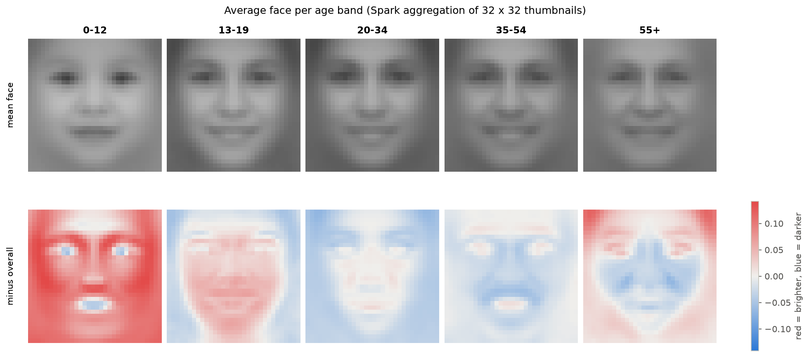
 
## Data Cleaning Summary
 
| Step | Images | Removed | Reason |
|---|---|---|---|
| Image files on disk | 23,708 | | |
| Decoded successfully | 23,708 | 0 | No corrupt files |
| Valid labels | 23,705 | 3 | Filenames missing the ethnicity field |
| Exact duplicates removed | 23,056 | 649 | Extra copies, and every copy of groups with conflicting labels |
 
## Feature Selection
 
P-value elimination doesn't apply to a CNN, so the input itself was tested with an ablation: the same network trained on four versions of the input.
 
| Input | Validation macro-F1 | Parameters |
|---|---|---|
| Colour 64 x 64 | 0.658 | 1.14M |
| **Grayscale 64 x 64** | **0.659** | 1.14M |
| Colour 32 x 32 | 0.639 | 0.36M |
| Colour 96 x 96 | 0.652 | 2.45M |
 
Colour added nothing, so it was dropped. Halving the resolution cost performance, so 64 x 64 was kept.
 
## Modelling
 
| | Baseline | Improved |
|---|---|---|
| Architecture | 3 conv blocks, flatten, dense 128 | 4 conv blocks with batch norm, global average pooling, dense 128 |
| Parameters | 1,142,021 | 422,821 |
| Augmentation | None | Flips, rotation, zoom, shifts, brightness, contrast |
| Regularisation | None | Dropout, L2, label smoothing 0.1 |
| Class weights | None | Balanced |
| Best epoch | 9 (of 15, early stopped) | 8 (of 18, early stopped) |
 
### Results (test set)
 
| Metric | Always "20-34" | Baseline | Improved |
|---|---|---|---|
| Accuracy | 40.5% | **68.7%** | 60.4% |
| Macro-F1 | 0.115 | **0.643** | 0.587 |
| Within one band | 70.2% | **97.2%** | 94.7% |
| Quadratic weighted kappa | 0.000 | **0.846** | 0.779 |
| 13-19 recall | 0% | 32.0% | **53.1%** |
 
The baseline overfitted. The improved model fixed that but was over-regularised: it underfitted, its validation score swung between 0.18 and 0.57, and early stopping cut it off while it was still learning. Class weighting raised teenager recall from 32% to 53%, but at too high a cost in false positives, so **the baseline is the recommended model**.
 
<table>
<tr><td>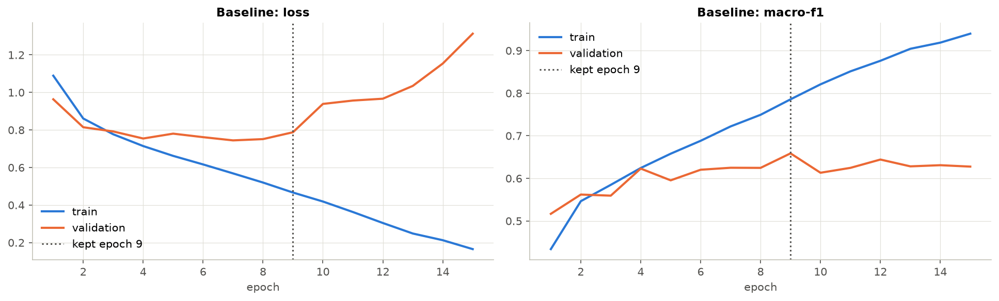</td><td>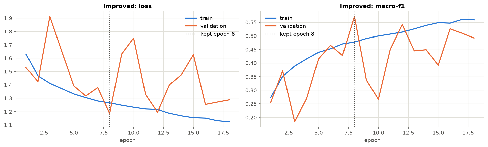</td></tr>
<tr><td align="center"><em>Baseline: overfits after epoch 9</em></td><td align="center"><em>Improved: no overfitting, but unstable validation</em></td></tr>
</table>
<table>
<tr><td>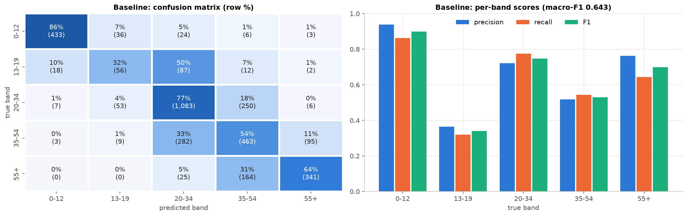</td></tr>
<tr><td>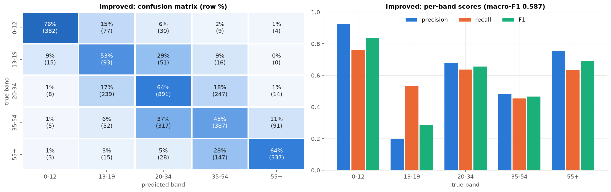</td></tr>
</table>
### What the model looks at
Grad-CAM shows the model focusing on the face rather than backgrounds or watermarks: the eyes for children, and the skin around the nose, cheeks and mouth for older faces.
 
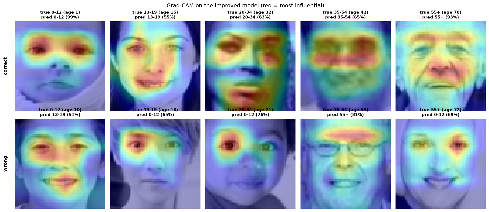
 
### Fairness
Both models score lowest for Black faces (baseline macro-F1 0.560 against 0.642 for White faces). That gap would need to be closed before any real-world use.
 
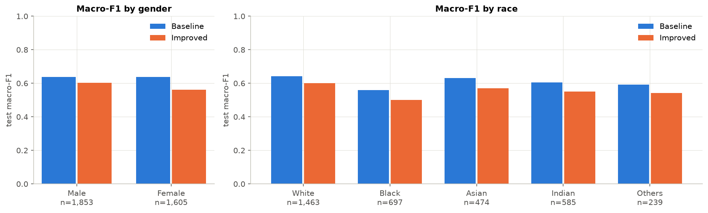
 
## Limitations
 
- The age labels are rounded estimates, and identical photos were sometimes given ages several years apart, so errors near band edges are partly label noise.
- The 13-19 band is the hardest to predict and the smallest.
- Accuracy is lower for Black faces in both models.
- Training ran on a CPU, which limited how long and how many models could be trained.
- UTKFace is for non-commercial research only, so a production system would need its own consented data and POPIA compliance.
## Setup and Reproduction
 
**Requirements:** Python 3.11, Java 17 (for Spark)
 
```bash
py -3.11 -m venv .venv
.venv\Scripts\activate
pip install "pyspark==3.5.9" "tensorflow==2.21.0" jupyter pandas numpy matplotlib seaborn scipy scikit-learn pillow pyarrow
```
 
1. Download the "Aligned & Cropped Faces" set from the [UTKFace page](https://susanqq.github.io/UTKFace/) (also mirrored on [Kaggle](https://www.kaggle.com/datasets/jangedoo/utkface-new)) and place the images directly in a `data/UTKFace/` folder.
2. Open `PDAN8412_ST10150702_POE_Part_3.ipynb` and run all cells in order. Training takes about 45 minutes on a CPU, and trained models are saved to `models/` so a rerun loads them instead of retraining.
## Author
 
**Jordan Muller** (ST10150702), PDAN8412 Portfolio of Evidence, Part 3
 